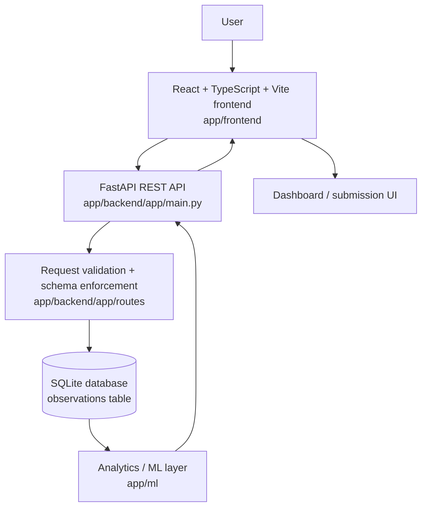

# CampusPulse architecture and data flow

This document describes the implementation that is actually present in the repository today. It focuses on the code paths used by the app in `app/backend`, `app/ml`, `app/frontend`, and the SQLite-backed persistence layer.

## 1. High-level architecture

The system is intentionally narrow and explainable:

- Frontend: submission form and dashboard UI in `app/frontend`
- Backend/API: FastAPI service with route-level validation and DB access in `app/backend/app`
- Database: SQLite with a single `observations` table and controlled categories/locations
- Analytics/ML: pandas-based statistical analysis and sklearn-based unsupervised models in `app/ml`
- Testing: backend pytest suite under `tests/` and frontend build checks via Vite

## 2. Repository structure and actual responsibilities

### Frontend

The frontend lives in `app/frontend` and is implemented as a React + TypeScript + Vite application.

Key files:

- `app/frontend/src/App.tsx` — main user flow (observation submission and dashboard views)
- `app/frontend/src/api.ts` — typed API helpers for the backend endpoints
- `app/frontend/src/styles.css` — layout and styling

The app has two main experiences:

1. Observation submission
   - fetches metadata from `/api/v1/observations/metadata`
   - renders controlled category and location selectors
   - submits observations to `POST /api/v1/observations`

2. Dashboard
   - fetches analytics from `/api/v1/analytics/summary`
   - fetches anomaly data from `/api/v1/analytics/anomalies`
   - fetches spatial intelligence from `/api/v1/analytics/spatial`
   - fetches NLP output from `/api/v1/analytics/nlp`
   - fetches clustering output from `/api/v1/analytics/clusters`
   - fetches relationship analysis from `/api/v1/analytics/relationships`

### Backend/API

The API entry point is `app/backend/app/main.py`.

It creates the FastAPI application, initializes the database on startup via `init_db()`, adds CORS for the local Vite client, and includes these routers:

- `/api/v1/observations` — submission and metadata endpoints
- `/api/v1/analytics` — analytics and ML endpoints
- `/health` — health check endpoint

The route modules are:

- `app/backend/app/routes/observations.py`
- `app/backend/app/routes/analytics.py`

### Database layer

The database layer is intentionally simple and uses SQLite directly through `sqlite3` connections.

Source files:

- `app/backend/app/database.py`
- `app/backend/app/config.py`

The database is initialized with an `observations` table. The schema includes:

- `id`: auto-increment primary key
- `created_at`: server-side creation timestamp
- `location`: configured campus location string
- `category`: controlled category string
- `severity`: integer 1–5
- `description`: free-text observation para
- `observed_at`: optional timestamp for the event time
- `approximate_location_id`: optional text label for a rough area ID
- `crowd_level`: optional integer 1–5
- `environmental_rating`: optional integer 1–5

The controlled category list and default location set are defined in `app/backend/app/config.py` via `CATEGORIES` and `DEFAULT_LOCATIONS`. The metadata endpoint exposes them to the frontend so the UI stays aligned with backend validation.

### Analytics / ML layer

The analytics and ML logic lives under `app/ml`:

- `anomaly.py` — Isolation Forest-based anomaly detection on aggregated location-day patterns
- `spatial.py` — zone-level spatial intelligence and heatmap-like outputs
- `nlp.py` — lexical sentiment, topic, and keyword analysis from free-text descriptions
- `clustering.py` — KMeans clustering over aggregated observation patterns
- `relationships.py` — Spearman correlation analysis for numeric feature pairs

These modules operate on pandas DataFrames produced from SQLite rows. They return dictionaries that match the API contracts expected by the frontend.

### Testing

The backend tests are in `tests/` and cover analytics behavior, anomaly handling, NLP output, demo-data generation, demo safety, clustering, and relationship analysis. The frontend is validated with `npm run build` inside `app/frontend`.

## 3. Data flow

### Observation submission flow

1. User opens the submission page in the React frontend.
2. The frontend calls `GET /api/v1/observations/metadata`.
3. The backend returns configured locations and categories from `ObservationMetadata`.
4. User enters one anonymous observation:
   - location
   - category
   - severity
   - optional crowd level
   - optional environmental rating
   - description
   - observed_at and approximate_location_id if present
5. The frontend posts the payload to `POST /api/v1/observations`.
6. `create_observation` validates the payload and writes a row into SQLite.
7. The API returns the stored row as a typed `Observation` response.
8. The frontend shows success or error feedback without altering the backend schema.

### Analytics flow

The analytics endpoints are not a single monolithic pipeline. Each endpoint reads the same `observations` table and computes a different kind of intelligence independently.

1. The frontend requests dashboard data from multiple summary endpoints.
2. Each route reads all rows from SQLite into a pandas DataFrame.
3. Statistical or ML processing is performed in the relevant `app/ml` module.
4. The result is a JSON dictionary returned to the frontend.
5. The React dashboard renders summary cards, charts, heatmaps, anomaly notices, NLP summaries, pattern clusters, and relationship output.

## 4. Analytics pipeline

The implemented pipeline follows these stages.

| Stage | Input | Processing | Output | Purpose |
|---|---|---|---|---|
| Data collection | Anonymous observation form | Validation and insertion into SQLite | Stored row in `observations` | Collect campus-environment observations without user accounts |
| Validation | API payload | FastAPI schema + DB constraints | Sanitized observation rows | Enforce controlled categories, locations, severity, and optional numeric bounds |
| Storage | SQLite rows | `get_db()` + `init_db()` | `observations` table | Persist structured campus observations |
| Feature preparation | Raw observation rows | `pd.DataFrame` conversion and field normalization | Numeric and time-aware feature sets | Prepare consistent analysis inputs |
| Exploratory/statistical analysis | Observation DataFrame | Summary grouping by category, location, time, severity | `summary` results | Provide totals, distributions, and temporal patterns |
| Anomaly detection | Aggregated location-day groups | `IsolationForest` on count/severity/crowd/environmental features | Unusual location-day patterns | Call out statistically unusual patterns |
| Spatial analysis | Observation DataFrame + configured locations | Zone aggregation and intensity scoring | Zone metrics and insights | Show where intensity is concentrated |
| NLP | Description text | Tokenization, stop words, sentiment lexicons, topic keyword matching | Sentiment/topic/keyword summaries | Summarize text themes and affect |
| Unsupervised clustering | Location-day aggregates | KMeans on feature profiles | Cluster summaries | Identify recurring similar patterns |
| Relationship analysis | Numeric variables | Pairwise Spearman correlations | Correlation summaries | Identify monotonic numeric relationships |
| Visualization | API JSON | React rendering in dashboard | Human-readable sections | Present intelligence in a UI |

## 5. Machine learning and analysis methods

### A. Isolation Forest

The anomaly detector is implemented in `app/ml/anomaly.py`.

- Purpose: identify unusual location-day patterns relative to the observed history
- Input features: `observation_count`, `average_severity`, `average_crowd_level`, `average_environmental_rating`
- Aggregation level: grouped by `location` + UTC day (`period_start`)
- Model: `sklearn.ensemble.IsolationForest`
- Output: structured anomaly entries containing location, date, dominant category, observed counts, average severity, crowd/environmental context, anomaly score, explanation
- Limitation: it does not indicate a problem by itself; it only indicates that a pattern is unusual compared with the current data history. It also has a minimum-data requirement: at least five valid location-day groups must exist.

The model input is built from aggregated location-day rows, and optional metric values are handled without dropping the whole group from the analysis; null values are handled locally when computing the relevant feature.

### B. KMeans clustering

The clustering logic is implemented in `app/ml/clustering.py`.

- Features used: `observation_count`, `average_severity`, and optionally `average_crowd_level` / `average_environmental_rating`
- Preprocessing: the raw aggregated rows are converted to numeric values, median-filled where needed, and standardized implicitly by the algorithm through the numeric feature matrix
- Cluster selection: tests multiple values of `k` and selects the best score using silhouette score, with a bounded valid candidate set
- Evaluation: cluster quality is measured via silhouette score; the system does not force a cluster count when the data is too sparse or too repetitive
- Output: cluster summaries with counts, percentages, feature profile, dominant category/location, and human-readable summary text
- Limitation: clustering is only meaningful when there are enough distinct location-day patterns; the implementation explicitly guards against unstable or degenerate cluster attempts

### C. Spearman relationship analysis

The relationship analysis is implemented in `app/ml/relationships.py`.

- Variables: `severity`, `crowd_level`, `environmental_rating`, and `sentiment_score` when present
- Why Spearman: it measures monotonic relationships between numeric variables without assuming a linear relationship
- Interpretation: it returns a coefficient plus a qualitative label such as `weak`, `moderate`, `strong`, or `very strong`
- Important caveat: correlation does not imply causation. The output is an observed statistical relationship, not a statement about effect or root cause.

### D. NLP

The NLP system is implemented in `app/ml/nlp.py`.

- Preprocessing: lower-case text, whitespace normalization, tokenization with regex, stop-word filtering, and numeric removal
- Sentiment method: simple lexical sentiment based on positive and negative word sets plus a score formula
- Topic detection: keyword dictionary matching across topical groups such as Wi-Fi, crowding, cleanliness, noise, maintenance, safety, and facilities
- Keyword extraction: counts tokens across all non-empty descriptions and reports the most common terms
- Limitations: this is not an LLM and not a deep-learning model. It is rule-based lexical analysis, so it is useful for rough topic and polarity summaries rather than semantic understanding or nuanced context.

## 6. Spatial architecture

Spatial analysis uses the configured campus zones rather than GPS.

- `app/backend/app/config.py` defines a controlled set of location names.
- The spatial module builds an abstract zone layout from those names.
- Observations are aggregated by `location` and then summarized into zone metrics.
- The `spatial_intelligence` function computes an abstract intensity score for each configured zone.

Important constraints from the implementation:

- CampusPulse does not use GPS coordinates.
- CampusPulse does not track individual movement.
- CampusPulse does not maintain exact personal location history.
- `approximate_location_id` is a free-form text label only, not a geolocation field.

This design is intentional. The system is privacy-safe and focused on area-level environment intelligence rather than individual tracking.

## 7. Privacy architecture

The implemented privacy posture is consistent with the actual code and schema.

The system does not include:

- accounts or user authentication
- names
- student IDs
- email addresses
- phone numbers
- GPS coordinates
- external text-transmission services for NLP
- any per-user location tracking

The observation model is anonymous by design: it stores text observations, controlled campus categories, and broad location labels. The frontend privacy notice also tells users not to include personal identifiers. There is no schema field for email, phone, or identity data, and there is no user table in the backend.

## 8. Operational flow through the app

The actual app flow is straightforward and consistent with the code:

1. `main.py` starts the API and initializes SQLite.
2. `/api/v1/observations/metadata` provides categories and locations.
3. The frontend presents the observation form.
4. The user submits a structured observation.
5. `create_observation` saves the row in SQLite.
6. The dashboard calls all analytics endpoints independently.
7. Each endpoint reads the current database state and returns JSON-ready analytics.
8. The React UI renders human-readable summary cards and sections.

## 9. What this architecture is designed to do

The repository implements a real, explainable campus data pipeline for anonymous observations. It is designed to answer questions such as:

- How many observations were collected?
- Which categories and locations dominate?
- Which areas are most intense or high-risk?
- Which times of day are busiest?
- Which location-day patterns look unusual?
- What themes emerge from the text descriptions?
- Which observation patterns cluster together?
- Which numeric features move together?

It does not attempt to identify individuals, predict future behavior, or rely on external AI services. Its intelligence is based on the observation history that is actually stored in the app's SQLite database.
